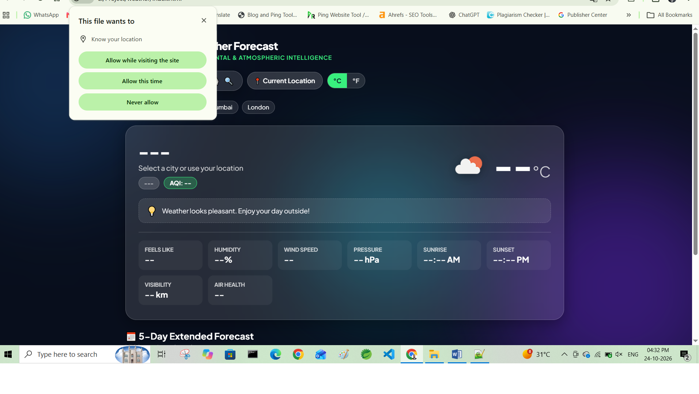

# ☁️ Abhiro Weather Forecast

A modern, responsive Single Page Application (SPA) providing real-time weather analytics, environmental intelligence, air quality indexing (AQI), and regional neighborhood radar triangulation.

---

## 📸 Preview & Screenshots



> **Note:** To display your screenshot in this repository, capture an image of your application running in the browser and save it directly in your project root as `screenshot.png`.

---

## 🌟 Key Features

* **Real-Time Weather Metrics:** Live temperature, "feels like" index, humidity, wind velocity, atmospheric pressure, and visibility.
* **Air Quality Index (AQI):** Telemetry tracking with health impact classifications (Healthy, Moderate, Unhealthy, Hazardous).
* **5-Day Extended Forecast:** Daily projections with temperature trends and weather icons.
* **Dynamic Regional Radar:** Triangulates radial GPS coordinates around any searched city to query and display 3 neighboring towns.
* **Sun Schedule:** Formatted local sunrise and sunset timings.
* **Voice Search:** Hands-free city searching powered by the browser's native Web Speech API.
* **Dual Unit System:** Instant mathematical conversion toggle between Metric (°C, m/s) and Imperial (°F, mph).
* **Smart Lifestyle Recommendations:** Context-aware weather advice (umbrella reminders, UV alerts, outdoor activity suggestions).
* **Adaptive Ambient Themes:** Dynamic background adjustments reflecting clear, cloudy, rainy, snowy, or nighttime conditions.
* **Recent Searches:** Quick-access chip bar powered by `localStorage`.

---

## 🛠️ Tech Stack

* **Frontend:** Semantic HTML5, CSS3 (Glassmorphism, Flexbox, CSS Grid)
* **Scripting:** Vanilla JavaScript (ES6+, Async/Await, Fetch API, Web Speech API)
* **Data Provider:** [OpenWeatherMap API](https://openweathermap.org/) (Current Weather, Air Pollution, 5-Day Forecast)
* **Hosting:** GitHub Pages

---

## 🚀 Local Installation & Setup

1. **Clone the repository:**
   ```bash
   git clone [https://github.com/MrTechRohit/live-weather.git](https://github.com/MrTechRohit/live-weather.git)
   cd live-weather
